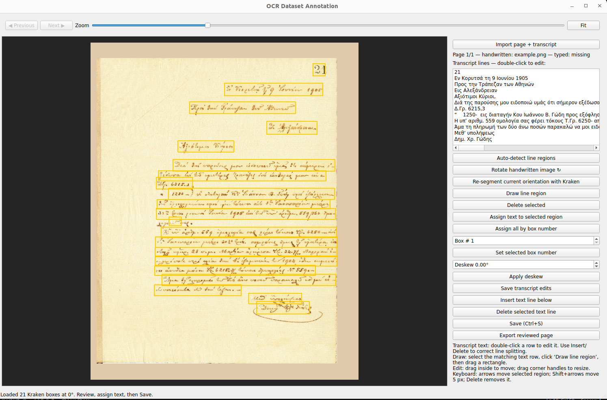

# OCR Dataset Annotation Tool

A small desktop application for creating reviewed OCR training pairs from page
scans and their known transcripts. It is designed to make the annotation step
auditable and independent of any particular OCR model.



The current core workflow is deliberately narrow:

```text
page scan + page transcript
        ↓
optional Kraken line proposals
        ↓
manual page rotation, box editing, and transcript line correction
        ↓
reviewed line-image/text pairs
```

Training, active learning, corpus rebuilding, and custom-model inference are
not required to use the application.

## Quick start

Requires Python 3.10 or newer.

```bash
git clone <your-repository-url>
cd OCR_Annotation_Tool
python3 -m venv .venv
.venv/bin/python -m pip install --upgrade pip
.venv/bin/python -m pip install -r requirements.txt
.venv/bin/python main.py
```

The first launch opens this repository as the annotation project. Add source
files using either approach:

1. In the UI, click **Import page + transcript** and choose one image and its
   UTF-8 `.txt` transcript.
2. Copy files directly into the source folders. Names must share an exact
   stem: `source/images/page_001.png` pairs with
   `source/transcripts/page_001.txt`.

The repository includes `example.png` and `example.txt` as a small example
pair. After importing or discovering a pair, use the UI to draw or correct
line regions, assign each transcript row, and select **Export reviewed page**.

## Project layout

```text
OCR_Annotation_Tool/
  main.py                         # Start the desktop UI
  source/
    images/                       # Local page scans (ignored by Git)
    transcripts/                  # Local page transcripts (ignored by Git)
    manifest.csv                  # Explicit imported-page mapping (ignored)
  annotations/                    # Local review output (ignored)
    pages/                        # Page JSON + previews
    line_pairs/                   # Exported PNG/text pairs
  Line_Breaking_Tool/
    line_breaking_tool.py         # PyQt5 review UI
  scripts/line_ocr/
    project_core.py               # Project storage and import logic
    manage_project.py             # Optional CLI project helper
  requirements.txt                # Core UI dependency
  requirements-kraken.txt         # Optional Kraken dependency
```

Files under `source/` and `annotations/` are local project data and are
ignored by default, except for the included example pair. This prevents scans,
transcripts, exports, and model artifacts from being accidentally committed.

## Using the reviewer

1. Choose **Re-segment current orientation with Kraken** to request a proposal
   when Kraken is installed, or use **Auto-detect line regions** as a simple
   local fallback.
2. Rotate or deskew the page before refining boxes.
3. Select, move, resize, add, or delete line boxes; select a transcript row
   and assign it to its matching box.
4. Edit transcript rows in the right panel. Insert or delete rows to make the
   known page transcript match the physical handwritten lines.
5. Choose **Export reviewed page**. Export is allowed only when every text row
   and every box has exactly one non-empty pairing.

Each exported page has a JSON record, a preview image, and a folder of cropped
line PNGs paired with UTF-8 text files.

## Optional Kraken proposals

Kraken is optional. Keep it in a separate environment if its dependencies
conflict with the core UI environment:

```bash
python3 -m venv .venv-kraken
.venv-kraken/bin/python -m pip install --upgrade pip
.venv-kraken/bin/python -m pip install -r requirements-kraken.txt
```

Make the `kraken` executable available on `PATH` when launching the UI, or
install Kraken in the same environment as the UI. The reviewer remains fully
usable without it.

## Command-line helpers

The UI is the normal entry point:

```bash
.venv/bin/python main.py
```

To work with a separate project folder instead of this repository:

```bash
.venv/bin/python main.py --project /path/to/my_ocr_project
```

To create a project or import a pair without opening the UI:

```bash
.venv/bin/python scripts/line_ocr/manage_project.py create /path/to/my_ocr_project
.venv/bin/python scripts/line_ocr/manage_project.py add-page /path/to/my_ocr_project scan.png transcript.txt
```

## License

This project is available under the [MIT License](LICENSE).
